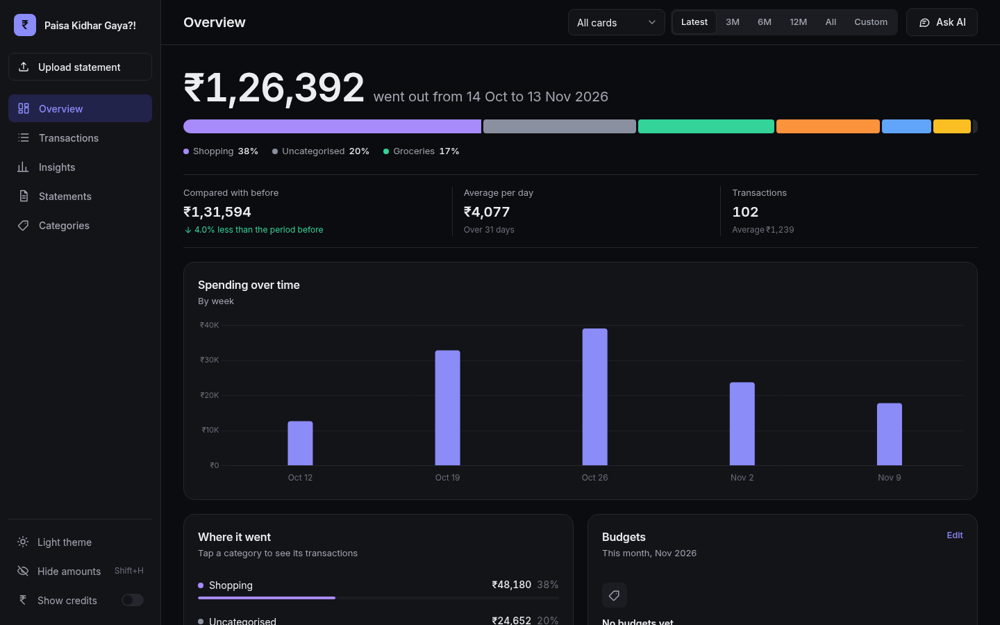
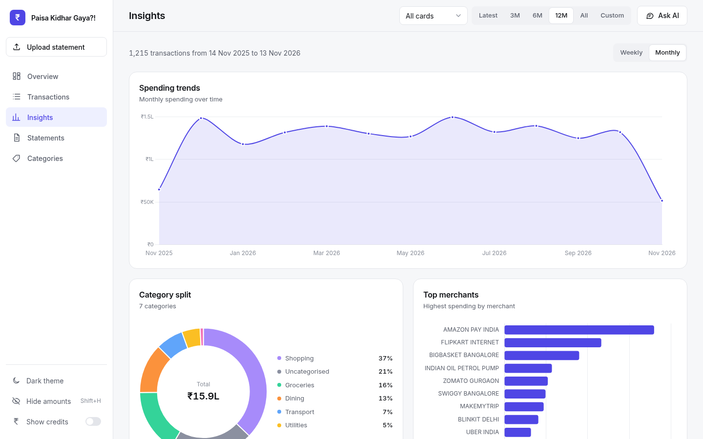
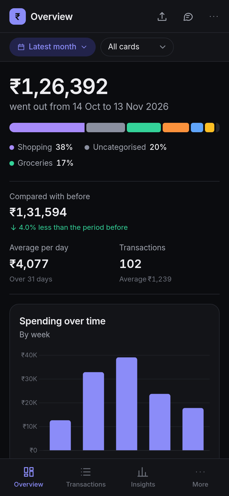

# Paisa Kidhar Gaya?!

**पैसा किधर गया?!** — *"Where did the money go?!"*

A personal expense analyzer for Indian credit card statements. Upload CSVs, get dashboards and charts — no cloud, no signup, everything stays on your machine.

## Screenshots



<table>
  <tr>
    <td width="68%"></td>
    <td width="32%"></td>
  </tr>
  <tr>
    <td align="center"><sub>Insights — trends, category split, top merchants (light theme)</sub></td>
    <td align="center"><sub>On your phone</sub></td>
  </tr>
</table>

<sub>All screenshots use synthetic data from <code>scripts/generate-demo-csvs.js</code>.</sub>

## Highlights

- **Instant visual analytics** — upload credit card CSVs and get interactive charts in seconds
- **AI assistant** — ask questions about your spending in plain English (local Ollama; data never leaves your device)
- **Multi-card support** — auto-detects bank and card number from 15 Indian banks
- **Answers the question first** — the Overview opens with how much went out and a single strip showing where it went; tap a category to see its transactions
- **Overview, Transactions and Insights** — global card + period filters that stay in the URL, a searchable transactions page, trends, category split, top merchants and day-of-week patterns
- **Built for your phone** — bottom tab bar, bottom sheets, installable as an app (PWA)
- **Privacy mode** — hide every amount with one tap or `Shift+H` when someone's looking at your screen
- **Light/dark theme** — plus a toggle to show or hide credit transactions
- **Secure by default** — CSRF protection, strict CSP, no third-party requests, optional app password
- **Zero config** — smart deduplication, format auto-detection, drag-and-drop upload

---

## Installation

Pick the path that matches how you want to run the app.

| Setup | Best for | Command |
|-------|----------|---------|
| **Local development** | Laptop / desktop, coding | `bun install && bun run dev` |
| **Production on one machine** | Same machine, no Pi | See [Option C](#option-c--production-on-your-laptop-no-pi) |
| **Raspberry Pi** | Always-on home server, also reachable from your own phone and laptop anywhere | `sudo ./deploy/setup.sh` |

### Prerequisites

- [Bun](https://bun.sh/) v1.1+ (installed automatically on Pi by `setup.sh` if missing)
- For Pi deployment: Raspberry Pi OS or Debian, **Pi 4 with 2 GB+ RAM** recommended

---

### Option A — Local development

Use this for everyday development on your laptop or desktop.

```bash
git clone https://github.com/rishi-chauhan/expense_tracker.git
cd expense_tracker
bun install
bun run dev
```

| Service | URL |
|---------|-----|
| Web UI | http://localhost:5173 |
| API | http://localhost:3000 |

Both dev servers listen on **localhost only**, so your real data isn't exposed on café or office Wi-Fi. To test on your phone over the LAN on purpose, run `bun run dev:vite -- --host` and start the backend with `HOST=0.0.0.0 ALLOWED_HOSTS=localhost,127.0.0.1,<laptop-ip>`.

**Try it with demo data** — no real statement needed. Generate 12 months of fake statements for two cards, then drag them into **Upload statement**:

```bash
bun scripts/generate-demo-csvs.js          # writes demo-data/*.csv (gitignored)
DB_PATH=data/demo.db bun run dev           # optional: keep demo data out of your real database
```

Optional: copy environment defaults if you need custom ports or DB path:

```bash
cp .env.example .env
# edit .env if needed
```

---

### Option B — Raspberry Pi (one command)

Run the app as an always-on service: Bun on localhost, **Caddy** for HTTPS + basic auth on the home LAN, **Tailscale** so your own phone and laptop can open it from anywhere, **systemd** for boot, nightly **SQLite backups**. Tailscale does not put the app on the public internet. You do not need a public IP or a router port-forward.

**On the Pi** (clone or rsync the repo first):

```bash
cd expense_tracker
sudo ./deploy/setup.sh
```

You will be prompted for a **basic-auth password** (or set it upfront):

```bash
sudo EXPENSES_ADMIN_PASSWORD='your-secret-password' ./deploy/setup.sh
```

`setup.sh` does everything in one run:

1. Installs system packages (`sqlite3`, `caddy`, `ufw`, `rsync`, `curl`)
2. Installs Bun if missing
3. Uses your existing login user (for example `admin`), syncs app to `/opt/expense_tracker`, runs `bun install` + build
4. Enables **systemd** service `expense-tracker`
5. Configures **Caddy** reverse proxy + basic auth (`tls internal`)
6. Applies **firewall** rules (LAN → SSH, 80, 443 only — never exposes `:3000`)
7. Schedules nightly **backup** cron
8. Verifies `GET /api/health`
9. Installs **Tailscale**, waits for you to approve the Pi, and publishes the app on your tailnet (`tailscale serve` → `127.0.0.1:3000`)

After setup:

1. Point **`expenses.home.lan`** at your Pi (router DNS or `/etc/hosts` on clients)
2. Open **https://expenses.home.lan** and sign in with the username `admin` (or `EXPENSES_ADMIN_USER`) and your password
3. Trust Caddy’s local TLS certificate once per device on the home LAN (or see [deploy/README.md](deploy/README.md))
4. On your phone and laptop, install Tailscale, sign in with the **same account** you used to approve the Pi, and open the `https://….ts.net` URL the script prints. Use that name in the browser. The `100.x.x.x` address is for SSH.

**Tip for weak Pis:** build on your laptop first, then rsync — see [deploy/README.md](deploy/README.md#pre-build-on-a-laptop-optional).

**Preview without changes:**

```bash
sudo DRY_RUN=1 ./deploy/setup.sh
```

**Useful env vars** (all optional):

| Variable | Default | Purpose |
|----------|---------|---------|
| `APP_USER` | invoking sudo user | Linux account that owns and runs the app (for example `admin`; never `root`) |
| `EXPENSES_HOST` | `expenses.home.lan` | Hostname in Caddy |
| `EXPENSES_ADMIN_USER` | `admin` | Basic-auth username; independent of `APP_USER` |
| `EXPENSES_ADMIN_PASSWORD` | (prompt) | Basic-auth password |
| `APP_ROOT` | `/opt/expense_tracker` | Install directory |
| `LAN_SUBNET` | auto-detect | ufw allow source |
| `SKIP_TAILSCALE` | `0` | Set `1` to skip Tailscale |
| `TAILSCALE_HOSTNAME` | `expenses` | Name of the Pi on your tailnet |
| `TAILSCALE_AUTH_KEY` | (unset) | Optional. Interactive login is the default |

Full Pi guide, restore steps, and troubleshooting: **[deploy/README.md](deploy/README.md)**

---

### Option C — Production on your laptop (no Pi)

Run a production build on the same machine without Caddy or systemd:

```bash
bun install
bun run build
cp .env.example .env
# ensure HOST=127.0.0.1 in .env for localhost-only binding
bun run start
```

Open http://localhost:3000 (API + built UI in one process).

---

## AI assistant (optional)

Requires [Ollama](https://ollama.ai/) running locally:

```bash
ollama pull qwen2.5:1.5b
ollama serve
```

On a Pi, bind Ollama to localhost only (`OLLAMA_HOST=127.0.0.1:11434`) — see [deploy/README.md](deploy/README.md#ollama-optional).

The AI translates questions into SQL, runs it on a read-only connection in a separate worker (killed after 3 seconds), and summarises the result. Set `OLLAMA_SUMMARIZE=0` to skip the summary step and just show the result table — about twice as fast on a Pi. If Ollama is not running, the chat panel says so.

Screenshots in issues or docs must only use synthetic data (`bun scripts/generate-demo-csvs.js` or `tests/fixtures/sample_valid.csv`), never real statements.

---

## How it works

1. **Upload** a credit card statement CSV (drag-and-drop or file picker)
2. **Auto-detect** — parser finds format, delimiter, bank name, and card number
3. **Parse & deduplicate** — transactions validated, deduplicated by hash, stored in SQLite
4. **Browse dashboards** — monthly trends, top merchants, debit/credit ratios, searchable transactions
5. **Ask AI** (optional) — e.g. *"how much did I spend on groceries last month?"*

## CSV format

The parser auto-detects the format. It looks for rows with `DATE` and `AMT` columns, supports `~|~` and `~` delimiters, and handles variable metadata rows.

**Example structure:**

```
Name~|~JOHN DOE
Card~|~xxxx-xxxx-xxxx-1234
...
Transaction type~|~Customer~|~DATE~|~Description~|~AMT~|~Debit /Credit~|~REWARDS
Domestic~|~Customer~|~25/12/2025~|~GROCERY STORE~|~1,234.56~|~~|~25
Domestic~|~Customer~|~26/12/2025~|~PAYMENT RECEIVED~|~5,000.00~|~Cr~|~0
```

Works with HDFC, ICICI, SBI, Axis, Kotak, and 10 other Indian banks. If detection fails, the app prompts for bank and card details manually.

## Tech stack

| Layer | Technology |
|-------|-----------|
| Runtime | [Bun](https://bun.sh/) |
| Frontend | React 19 + Vite |
| Charts | Chart.js + react-chartjs-2 |
| Database | SQLite (Bun native driver) |
| Font | Inter (self-hosted via `@fontsource-variable/inter`) |
| AI | Ollama + Qwen 2.5 1.5B |
| Testing | Vitest + React Testing Library |

## Development

```bash
bun run dev          # full-stack dev (API :3000, Vite UI :5173)
bun run build        # production build → dist/ (+ precompressed .br/.gz)
bun run start        # production server (needs dist/)
bun run test         # vitest (watch mode)
bun run test:bun     # bun:sqlite server tests (security, auth, routes, …)
bun run test:all     # vitest --run + bun sqlite server tests
bun run lint         # ESLint
bun scripts/generate-demo-csvs.js   # synthetic statements for demos/screenshots
```

See [TESTING.md](TESTING.md) for the full test suite.

## Deploy scripts reference

| Script | Purpose |
|--------|---------|
| **`deploy/setup.sh`** | **One-shot Pi install** (recommended) |
| `deploy/install.sh` | App layer only (systemd, build) — used by `setup.sh` |
| `deploy/backup.sh` | Manual or cron SQLite backup |
| `deploy/README.md` | Detailed Pi ops guide |

## Contributing

1. Fork the repo and create a feature branch
2. Make your changes
3. Run `bun run test -- --run` and `bun run lint` — all checks must pass
4. Open a pull request

## License

MIT — see [LICENSE](LICENSE) for details.
